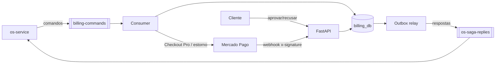

# fiap-officine-billing-service

[](https://sonarcloud.io/summary/new_code?id=fiap-officine_fiap-officine-billing-service)
[](https://sonarcloud.io/summary/new_code?id=fiap-officine_fiap-officine-billing-service)

Microsserviço de **orçamentos e pagamentos** da oficina. Participante da saga
orquestrada pelo [os-service](https://github.com/fiap-officine/fiap-officine-os-service).
Tech Challenge SOAT — Fase 4.

| | |
|---|---|
| Responsabilidades | Gerar orçamento, aprovação/recusa pelo cliente, cobrança no **Mercado Pago**, webhook de pagamento, estorno (compensação) |
| Banco | PostgreSQL `billing_db` (banco lógico e usuário próprios) |
| Consome | `billing-commands`: `GerarOrcamento`, `SolicitarPagamento`, `EstornarPagamento`, `CancelarOrcamento` |
| Publica | `os-saga-replies`: `OrcamentoGerado/Falhou/Aprovado/Recusado/Cancelado`, `PagamentoSolicitado/Confirmado/Recusado/Estornado` |



## Mercado Pago

| Etapa | Implementação |
|---|---|
| Cobrança | Preferência do **Checkout Pro** (`sdk.preference().create`) com `external_reference = pagamento_id`, `notification_url` e expiração. O link (`sandbox_init_point` em homolog) volta para a saga em `PagamentoSolicitado` e fica em `GET /api/v1/pagamentos/{id}` |
| Webhook | `POST /api/v1/pagamentos/webhook` — rota **pública** no API Gateway (sem JWT). Valida o header `x-signature` (HMAC-SHA256 de `id:<data.id>;request-id:<x-request-id>;ts:<ts>;` com a assinatura secreta) → 401 se inválido |
| Confirmação | O corpo do webhook não é confiável: o status é **reconsultado** em `GET /v1/payments/{id}` antes de publicar `PagamentoConfirmado`/`PagamentoRecusado`. Notificações repetidas são ignoradas |
| Fallback | Se o webhook não chegar, um job reconcilia cobranças pendentes via `GET /v1/payments/search?external_reference=` |
| Compensação | `EstornarPagamento` → `POST /v1/payments/{id}/refunds` (estorno total). Idempotente: sem pagamento aprovado responde `estorno_necessario=false` |
| Pagamento tardio | Pago depois que a saga cancelou o orçamento → estorno automático imediato |

Para testes automatizados e desenvolvimento sem credenciais: `PAYMENT_GATEWAY=fake`
(interface `PaymentGateway` com `MercadoPagoGateway` e `FakeGateway`) e
`POST /api/v1/pagamentos/{id}/simular {"status": "approved"|"rejected"}`.

### Configurando o sandbox

1. *Suas integrações* → criar aplicação → **credenciais de teste** (`TEST-...`) em `MP_ACCESS_TOKEN`.
2. Criar **usuários de teste** (vendedor e comprador); pagar com o comprador e os [cartões de teste](https://www.mercadopago.com.br/developers/pt/docs/checkout-pro/additional-content/your-integrations/test/cards).
3. *Webhooks* → URL `https://<api-gateway>/api/v1/pagamentos/webhook`, evento **Pagamentos**; copiar a **assinatura secreta** para `MP_WEBHOOK_SECRET`.
4. Usar "Simular notificação" no painel para testar a rota.

## API

Swagger: `/billing/docs` · [docs/openapi.json](docs/openapi.json)

| Método | Rota | Quem |
|---|---|---|
| GET | `/api/v1/orcamentos?os_id=` | cliente (só os próprios) / operador |
| GET | `/api/v1/orcamentos/{id}` | dono ou operador |
| POST | `/api/v1/orcamentos/{id}/aprovar` | dono ou operador → `OrcamentoAprovado` |
| POST | `/api/v1/orcamentos/{id}/recusar` | dono ou operador → `OrcamentoRecusado` |
| GET | `/api/v1/pagamentos/{id}` · `?orcamento_id=` | dono ou operador (status + link do checkout) |
| POST | `/api/v1/pagamentos/webhook` | Mercado Pago (assinatura) |
| POST | `/api/v1/pagamentos/{id}/simular` | só com `PAYMENT_GATEWAY=fake` |
| GET | `/billing/health` | banco, SQS, outbox, provedor |

Autenticação: JWT da Lambda (cliente, claim `cliente_id`) ou do OS Service
(operador, `role=admin`), validado com o segredo compartilhado — o Billing não
acessa a base de clientes.

## Garantias de mensageria

Mesmo padrão do OS Service: **Transactional Outbox** (tabela `outbox`),
**consumidor idempotente** (`processed_messages`), DLQ após 5 tentativas.
Todos os handlers são idempotentes (ex.: `GerarOrcamento` repetido reenvia o
mesmo `OrcamentoGerado`; `SolicitarPagamento` repetido reaproveita a cobrança).
Contratos: [docs/contracts](docs/contracts/README.md).

## Rodando e testando

```bash
cp .env.example .env         # credenciais locais (o compose lê DB_PASSWORD daqui)
docker compose up --build     # Postgres + LocalStack + billing (gateway fake)
uv run pytest                 # unit + integração; falha abaixo de 80%
```

Cobertura atual: **93%** (branch coverage).

## CI/CD e infra

- [ci-cd.yml](.github/workflows/ci-cd.yml): lint → testes (≥80%) → SonarCloud →
  ECR (tag SHA) → bootstrap do `billing_db` → Kustomize + `rollout status` → smoke test.
- [infra/](infra/) (Terraform): fila `billing-commands` + DLQ e política IAM.
- Segredos (`MP_ACCESS_TOKEN`, `MP_WEBHOOK_SECRET`, banco, JWT) vêm de GitHub
  Secrets e viram Secret do Kubernetes no deploy — nunca versionados.
